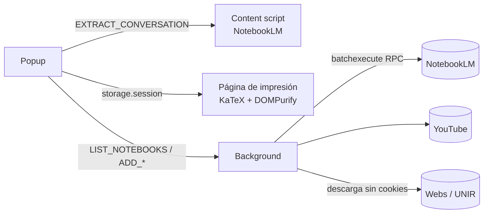

# Tools for Gemini Notebook

[](https://github.com/adriandizdev/tools-for-gemini-notebook/actions/workflows/ci.yml)
[](https://sonarcloud.io/summary/new_code?id=448dd395-f4cc-4d08-a8da-edf074d8546f_tools-for-gemini-notebook)


[](LICENSE)

Extensión de Chrome que amplía **Gemini Notebook** (antes _NotebookLM_) desde un único panel:

- **Exporta conversaciones a PDF conservando las fórmulas** matemáticas.
- **Añade como fuentes** de un cuaderno vídeos y listas de YouTube, los PDF, Word y PowerPoint de cualquier web y los temas del campus virtual de UNIR, sin salir de la página.

> **English summary:** Chrome extension (Manifest V3, TypeScript, WXT) that extends Gemini Notebook (formerly Google NotebookLM). It exports chats to PDF while keeping LaTeX formulas intact, and adds YouTube videos and playlists, web documents (PDF/DOCX/PPTX) and UNIR course topics as notebook sources. The project, code comments and UI are in Spanish.

<!-- TODO: añadir un GIF por funcionalidad en docs/ -->
<!--  -->

## Funcionalidades

| Dónde estás                     | Qué ofrece el panel                                                                                                                                   |
| ------------------------------- | ----------------------------------------------------------------------------------------------------------------------------------------------------- |
| Un cuaderno de NotebookLM       | **Exportar conversación a PDF**, con o sin tus preguntas. Las fórmulas se renderizan de nuevo con KaTeX a partir de su LaTeX original.                |
| Un vídeo o una lista de YouTube | **Añadir a cuaderno.** Omite los vídeos que ya están, respeta el máximo de fuentes del plan y resume los añadidos, los ya presentes y los rechazados. |
| Cualquier web                   | **Buscar documentos** PDF, DOCX y PPTX enlazados (o el PDF abierto), mostrar su tamaño y subir los elegidos al cuaderno.                              |
| Visor de temas de UNIR          | **Listar los temas** de la asignatura y añadir sus PDF como fuentes.                                                                                  |

## Instalación

Requisitos: Node 22 o superior y Chrome.

```bash
npm install
npm run build
```

Después, en `chrome://extensions`, activa el **modo desarrollador**, pulsa **Cargar descomprimida** y elige la carpeta `.output/chrome-mv3/`.

También puedes descargar el `.zip` de la última [release](../../releases) y descomprimirlo.

## Stack

- **TypeScript 7** y **[WXT](https://wxt.dev)** (Vite) para la extensión Manifest V3.
- **KaTeX** para las fórmulas y **DOMPurify** para sanear el HTML. Van empaquetados, porque MV3 prohíbe el código remoto.
- **Vitest** con **jsdom**: 170 tests sobre fixtures reales de NotebookLM, YouTube y UNIR.
- **oxlint** con reglas que usan tipos (sin `any`) y **Prettier**.
- **GitHub Actions** ejecuta tipos, lint, formato, tests y build en cada push.

## Arquitectura



- **La lógica de negocio es pura y se prueba sin navegador.** `utils/add-sources.ts` y `utils/add-documents.ts` deciden duplicados, cupos y mensajes; el acceso a NotebookLM y YouTube se inyecta como interfaz (`SourceBackend`).
- **Cada sistema externo tiene un único punto de acoplamiento:** el DOM de NotebookLM en `utils/selectors.ts`, su RPC interno en `utils/notebooklm-api.ts` y la API de UNIR en `utils/injected/unir-page.ts`. Cada uno tiene fixtures capturados de la página real.
- **El background hace las llamadas largas**, porque el popup se cierra al perder el foco. El progreso llega por un puerto.

Más detalle en [`docs/ARCHITECTURE.md`](docs/ARCHITECTURE.md). Los requisitos de cada funcionalidad (formato EARS, reglas de negocio y mensajes) están en [`specs/`](specs/).

## Decisiones técnicas y retos

- **PDF con la impresión nativa de Chrome, no con una librería de PDF.** Así se conserva la fidelidad de las fórmulas, a cambio de mostrar el diálogo de impresión.
- **Las fórmulas viajan como LaTeX, no como HTML de KaTeX.** NotebookLM guarda el LaTeX en `data-math`. Al renderizarlo de nuevo se evitan desajustes de versión con el CSS, se recupera el MathML y el tamaño baja mucho: unos 400 KB de HTML por respuesta frente al límite de unos 10 MB de `storage.session`.
- **Ingeniería inversa de NotebookLM.** No tiene API pública: se usan sus RPC `batchexecute` y la subida reanudable de ficheros. Un hallazgo: los vídeos que rechaza **se quedan en el cuaderno como fuentes con error**, así que la extensión las borra después.
- **Seguridad.** La página de impresión tiene acceso a las APIs de la extensión y recibe HTML externo, así que se sanea siempre. El token del campus de UNIR **nunca sale de la página**: la API se llama solo desde funciones inyectadas en esa pestaña. El acceso a todas las webs es un permiso opcional que se pide solo al usarlo.
- **Funciones inyectadas autocontenidas.** `scripting.executeScript` serializa la función, así que `utils/injected/scan-page.ts` y `utils/injected/unir-page.ts` no pueden importar nada.

## Desarrollo

```bash
npm run dev       # Chrome con la extensión y recarga en caliente
npm test          # Vitest
npm run test:coverage  # Vitest con cobertura (coverage/lcov.info, la usa SonarQube Cloud)
npm run compile   # comprobación de tipos
npm run lint      # oxlint
npm run format    # Prettier
npm run zip       # paquete para la Chrome Web Store
```

## Limitaciones

- Depende de APIs **internas y no documentadas** de NotebookLM, YouTube y UNIR. Si cambian, la extensión puede dejar de funcionar hasta que se actualice.
- Los documentos se descargan sin cookies, así que no se pueden añadir los que exigen iniciar sesión (salvo los temas de UNIR).
- NotebookLM solo admite `.pdf`, `.docx` y `.pptx`; los `.doc` y `.ppt` antiguos no.

## Hoja de ruta

- Interfaz en inglés (`browser.i18n`).
- Publicación en la Chrome Web Store.

## Aviso legal

Proyecto personal y educativo, **no oficial**. No tiene relación con Google, YouTube ni la Universidad Internacional de La Rioja (UNIR), ni cuenta con su respaldo. NotebookLM, Gemini y YouTube son marcas de Google LLC.

La extensión actúa con la sesión del propio usuario. Cada usuario es responsable de cumplir los términos de servicio de cada plataforma y de respetar los derechos de autor del material que añade. Consulta también la [política de privacidad](PRIVACY.md).

## Licencia

[MIT](LICENSE) © Adrian DG
