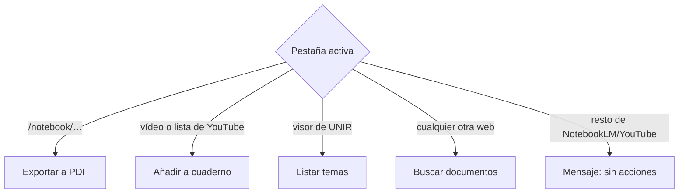
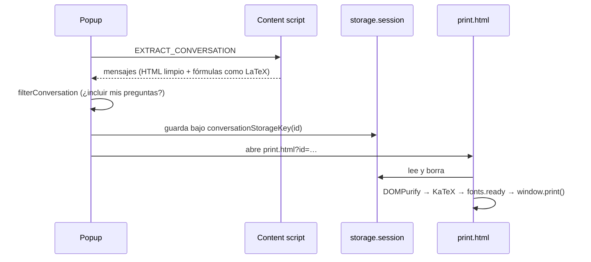

# Arquitectura

La extensión es Manifest V3 y se construye con WXT. Tiene cuatro contextos, cada uno con su papel:

| Contexto            | Archivo                     | Papel                                                                                                               |
| ------------------- | --------------------------- | ------------------------------------------------------------------------------------------------------------------- |
| Popup               | `entrypoints/popup/`        | Clasifica la pestaña activa (`classifyTab`, `utils/page.ts`) y muestra solo la acción que corresponde.              |
| Content script      | `entrypoints/content.ts`    | Solo en NotebookLM: extrae la conversación del DOM.                                                                 |
| Background          | `entrypoints/background.ts` | Hace las llamadas a NotebookLM, YouTube y las webs con la sesión del usuario. Sigue vivo aunque el popup se cierre. |
| Página de impresión | `entrypoints/print/`        | Sanea y renderiza la conversación y llama a `window.print()`.                                                       |



## Exportar a PDF



- `utils/extract.ts` quita la interfaz (citas, botones, atributos de Angular) y sustituye cada fórmula KaTeX por su LaTeX (`data-math`).
- `utils/sanitize.ts` permite MathML, SVG, `img` con `data:` y `style`/`class`/`data-*`. Nada más.
- `entrypoints/print/print.css` evita que los saltos de página partan fórmulas y tablas.

## Añadir fuentes

Las tres funcionalidades siguen el mismo patrón:

```
popup ──mensaje/puerto──▶ background ──▶ reglas puras ──▶ backend inyectado ──▶ APIs externas
                                         add-sources.ts     source-backend.ts
                                         add-documents.ts   document-backend.ts
```

- **Las reglas puras** (`utils/add-sources.ts`, `utils/add-documents.ts`) deciden duplicados, cupo de fuentes, recuentos y qué mensaje mostrar. Reciben el backend como interfaz y se prueban con dobles.
- **Los backends** implementan esa interfaz sobre `utils/notebooklm-api.ts`, `utils/youtube-playlist.ts` y la descarga de documentos.
- **YouTube (REQ-001):** las listas se leen de `ytInitialData` (los primeros 100 vídeos) y el resto se pagina con `/youtubei/v1/browse`.
- **Documentos web (REQ-002):** `utils/scan-page.ts` se inyecta en la página, se filtra y deduplica con `utils/documents.ts`, y los tamaños se piden con `HEAD` (6 en paralelo, 3 s como máximo). El progreso llega por un puerto (`ADD_DOCUMENTS_PORT`).
- **UNIR (REQ-003):** reutiliza REQ-002. La lista y el enlace de descarga de cada tema salen de la API del visor, que se llama desde `utils/unir-page.ts`, inyectada en la pestaña, para que el token no salga de ella.

## Integración con NotebookLM

NotebookLM no tiene API pública. `utils/notebooklm-api.ts` es el único módulo que conoce sus RPC internos (`batchexecute`):

| RPC                     | Uso                                                                    |
| ----------------------- | ---------------------------------------------------------------------- |
| `wXbhsf`                | Lista cuadernos, fuentes y límites del plan.                           |
| `izAoDd`                | Añade URLs (vídeos).                                                   |
| `tGMBJ`                 | Borra fuentes, por ejemplo los vídeos rechazados que quedan con error. |
| `o4cbdc` + `/upload/_/` | Registra una fuente de fichero y la sube en dos pasos (reanudable).    |
| `b7Wfje`                | Renombra una fuente.                                                   |

Las respuestas reales están en `utils/__fixtures__/notebooklm-rpc/`. Si Google cambia el protocolo, se actualizan juntos el módulo y los fixtures. Las notas de verificación (fechas y comportamientos comprobados) están en [`CLAUDE.md`](../CLAUDE.md).

## Tests

- Vitest con jsdom (DOMPurify no sanea bien con happy-dom).
- Los tests de extracción y de RPC usan fixtures capturados de las páginas reales.
- Los textos al usuario (`utils/messages.ts`) se prueban contra la tabla de mensajes aprobada en cada spec.
